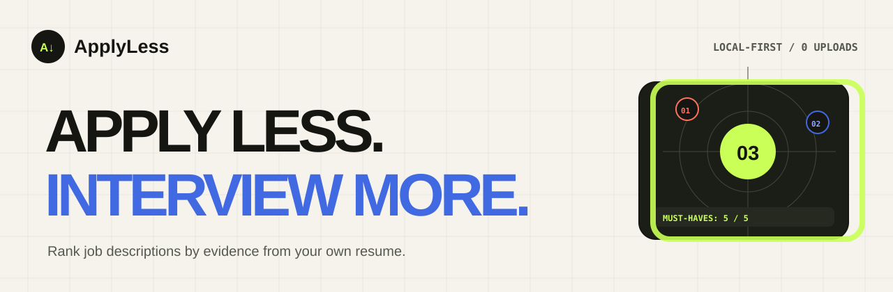
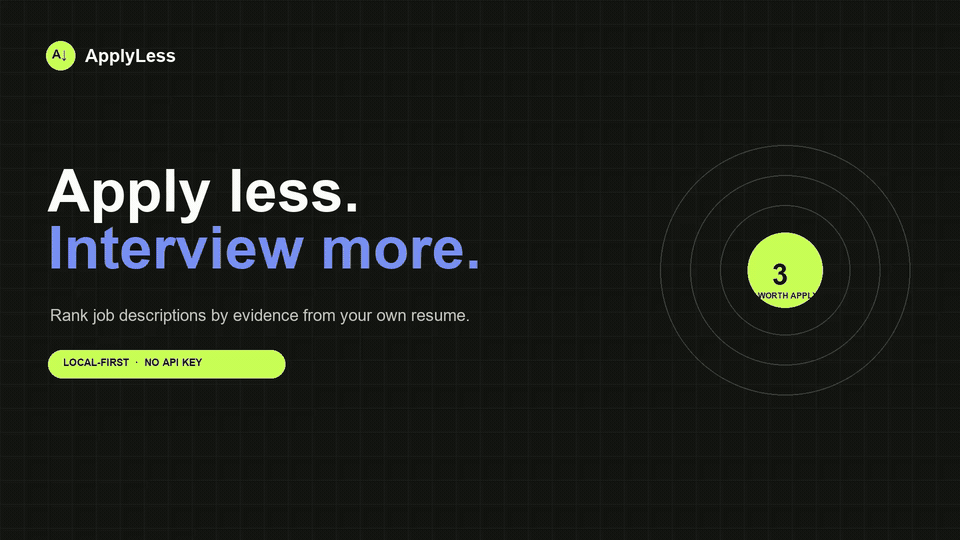

<p align="center">
  
</p>

<p align="center">
  <strong>Rank job descriptions by evidence from your resume — locally, without an API key.</strong><br>
  Stop spending evenings tailoring applications for roles that were never a serious fit.
</p>

<p align="center">
  <a href="#quickstart">Quickstart</a> ·
  <a href="#how-it-works">How it works</a> ·
  <a href="#privacy">Privacy</a> ·
  <a href="#roadmap">Roadmap</a> ·
  <a href="#中文说明">中文说明</a>
</p>

<p align="center">
  <a href="docs/applyless-demo.mp4">
    
  </a>
</p>

<p align="center">
  <sub>28-second demo · <a href="docs/applyless-demo.mp4">watch the full MP4</a></sub>
</p>

> **Status:** v0.1 alpha. The matching engine is transparent and intentionally
> conservative. It supports pasted resume text and one or many job descriptions.

## Why ApplyLess?

Most job-search tools optimize one application. The real waste happens before
that: spending an hour on a role where you are missing a hard requirement, or
skipping a role where your experience already matches the evidence.

ApplyLess treats job search as a **triage problem**:

- paste one resume and a pile of job descriptions;
- rank the roles by must-have coverage and verified source evidence;
- see exactly which resume line supports each match;
- surface costly gaps and suspicious job-description language;
- decide where to spend the next hour.

It is a local decision aid, not an auto-application bot and not a hiring
prediction.

## What it does

- **Batch shortlist:** compare many JDs in one pass.
- **Evidence, not vibes:** every matched requirement points to an actual resume line.
- **Must-have weighting:** explicit requirements count twice as much as preferences.
- **Explainable scoring:** inspect the four inputs behind every score.
- **Risk scan:** catch vague compensation, extreme availability, and over-specified roles.
- **Actionable next steps:** turn missing requirements into prompts for truthful evidence.
- **Local-first:** no account, no API key, no resume upload.
- **Import real files:** TXT, Markdown, and DOCX work with the standard library;
  PDF is supported through the optional local `pypdf` parser.
- **Zero required dependencies:** Python’s standard library is enough.

## Quickstart

Requirements: Python 3.11 or newer.

```bash
git clone <this-repository>
cd applyless
python -m venv .venv

# Windows
.venv\Scripts\activate
# macOS / Linux
source .venv/bin/activate

python -m pip install -e .
applyless serve --open
```

The app opens at `http://127.0.0.1:8765`. Click **Load sample** to try the
fictional demo without using personal data.

On Windows, the included launcher also keeps Python, pip, npm, and temporary
build caches on `D:`:

```powershell
.\scripts\run.ps1
```

Or double-click `scripts\run.cmd`. The launcher creates the project virtual
environment beside the repository and uses `D:\ProjectCaches` for package and
bytecode caches. Change `$CacheRoot` in the launcher if D is not your preferred
drive.

To read PDF resumes locally, install the optional parser:

```bash
python -m pip install -e ".[pdf]"
```

### CLI

```bash
applyless score --resume samples/resume.txt --jobs samples/jobs.txt
applyless score --resume samples/resume.txt --jobs samples/jobs.txt --json
```

Example output:

```text
ApplyLess - 3 roles ranked on resume evidence

#1  85/100  Strong fit
     Machine Learning Intern @ Northstar Labs
     Strong evidence in 6 recognized requirements, including Pandas; the main opportunity is sharper, measurable proof.
     Evidence: Pandas, Python, SQL, scikit-learn

#2  49/100  Stretch
     Analytics Intern @ BrightCart
     Your resume shows 3/7 must-have skills. Address Tableau before investing in a tailored application.
```

### Job-description format

Separate multiple jobs with a line such as:

```text
=== Machine Learning Intern | Northstar Labs ===
Company: Northstar Labs
Role: Machine Learning Intern
Location: Shanghai / hybrid
Salary: 250–350 CNY per day

Requirements:
- Strong Python and SQL
- Experience with pandas and scikit-learn

Preferred:
- PyTorch
```

Plain text also works. Section names such as `Requirements`, `Preferred`,
`岗位要求`, `加分项`, and `任职要求` improve must-have versus preferred
classification.

## How it works

```text
resume + job descriptions
          │
          ▼
parse requirements ──► classify must-have / preferred
          │
          ▼
find skill aliases ──► attach exact resume evidence
          │
          ▼
transparent score ──► rank, gaps, risks, next actions
```

The v0.1 score is based on:

| Input | Weight | Meaning |
|---|---:|---|
| Must-have coverage | 20% | Share of recognized hard requirements with evidence |
| Overall evidence coverage | 68% | Weighted requirement coverage (must-have = 2× preferred) |
| Proof quality | 7% | Whether a requirement has multiple supporting resume lines |
| Role-title alignment | 5% | Whether the role language appears in the resume |

The engine does **not** use age, gender, nationality, school prestige, or other
protected traits. Scores are capped at 99 to reinforce that this is a heuristic,
not a hiring verdict.

Known limitations:

- The v0.1 taxonomy recognizes common data, software, product, design, and
  marketing skills; niche domains may have lower confidence.
- Requirement extraction works best with bullets and clear headings.
- The score does not understand the full semantic meaning of every sentence.
- Scanned/image-only PDFs need OCR, which is not included in v0.1.

## Privacy

- The server binds to `127.0.0.1` by default.
- Resume and job text are processed in memory and are not logged.
- There are no analytics, external fonts, CDNs, trackers, or model requests.
- Request bodies are capped at 1 MB.
- Closing the local server clears the in-memory analysis result.

Read [SECURITY.md](SECURITY.md) for the threat model and reporting process.

## Development

Run the tests with no third-party test runner:

```bash
python -m unittest discover -s tests -v
```

On Windows, `.\scripts\test.ps1` also keeps caches off the system drive.

Run the local server from source:

```bash
python -m pip install -e .
applyless serve --open
```

## Roadmap

- [x] TXT, DOCX, and optional PDF text adapters with local-only parsing
- [ ] Paste-friendly extraction from job-board HTML
- [ ] Saved local shortlist history with an explicit delete control
- [ ] User-editable skill taxonomy and requirement weighting
- [ ] Better Chinese/English requirement classification
- [ ] Optional local-model adapter with visible model and data-flow boundaries
- [ ] Benchmark set of synthetic resume/JD pairs with reproducible scoring tests
- [ ] One-click static demo that runs entirely in the browser

The roadmap is deliberately focused on **decision quality**, not generating
more content for its own sake.

## Contributing

The most useful contributions right now are:

1. Add a failing synthetic test that exposes a real parsing or ranking mistake.
2. Improve an alias or requirement pattern without making the taxonomy broader
   than it can reliably explain.
3. Test the app with a anonymized job description from a domain that is poorly
   covered.
4. Improve accessibility, privacy, or documentation.

Please do not submit real resumes or job applications. Use fictional or
irreversibly anonymized data.

If ApplyLess saves you one hour of misdirected effort, a star helps other job
seekers find it.

## License

[MIT](LICENSE)

---

## 中文说明

项目名为 **ApplyLess**：帮助你从一批职位描述中筛出最值得投递的岗位，并把
“为什么匹配”落到简历中的真实证据上，而不是编造经历。

它不是自动投递工具，也不能预测录用结果。v0.1 的目标很具体：

1. 一次比较多个 JD，而不是逐份手工判断；
2. 硬性要求缺口一眼可见；
3. 每个匹配项都能回到简历原文；
4. 不上传简历、不需要 API Key，数据留在本机；
5. 评分规则公开，便于修改和复核。

启动方式：

```bash
python -m pip install -e .
applyless serve --open
```

打开后点击 **Load sample** 可加载完全虚构的示例。隐私说明、评分方法和已知
限制见上文。

